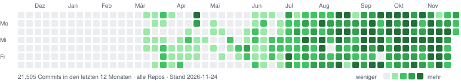

  <picture>
    <source media="(prefers-color-scheme: dark)" srcset="https://raw.githubusercontent.com/Janeway-Technology/.github/main/assets/wortmarken/janeway-technology-dunkel.svg">
    
  </picture>

<b>Software mit Fokus auf Datenhoheit und Datenschutz, entwickelt und betrieben in Deutschland.</b>

  <a href="https://janeway-technology.com">janeway-technology.com</a> ·
  <a href="https://janeway.io">janeway.io</a> ·
  <a href="mailto:contact@janeway.io">contact@janeway.io</a>

---

## Überblick

Janeway Technology ist ein Softwareunternehmen aus Neuruppin. Wir bauen Software, bei der die Daten dort bleiben,
wo sie hingehören: auf eigenen Servern in Deutschland, DSGVO-konform und ohne Abhängigkeit von US-Clouds.

## Aktivität

<picture>
  <source media="(prefers-color-scheme: dark)" srcset="https://raw.githubusercontent.com/Janeway-Technology/.github/main/assets/heatmaps/org-dunkel.svg">
  
</picture>

<!-- org-listen:anfang (erzeugt: janeway-suite/dev/org-profil.py) -->
## Janeway Projekte

### Janeway Suite

Selbst gehostete Produktivitäts-Suite mit der KI-Assistentin Jane. Jede App und jeder Dienst hat ein eigenes Repo, die Übersicht liegt in der [Wurzel](https://github.com/Janeway-Technology/janeway-suite). 80 Repos.

<b>Apps</b> (29)

| Repo | Worum es geht | Adresse |
|---|---|---|
| [janeway-admin](https://github.com/Janeway-Technology/janeway-admin) | Admin-Konsole der Janeway Suite | [admin.janeway.io](https://admin.janeway.io/) |
| [janeway-affiliate](https://github.com/Janeway-Technology/janeway-affiliate) | Affiliate-Portal (Self-Service) über alle aktiven Partner-Apps | [affiliate.janeway.io](https://affiliate.janeway.io/) |
| [janeway-ai-chat](https://github.com/Janeway-Technology/janeway-ai-chat) | Multi-Provider-KI-Chat über ai-core mit Credits und Plattform-Billing | [chat.janeway.io](https://chat.janeway.io/) |
| [janeway-api-docs](https://github.com/Janeway-Technology/janeway-api-docs) | Öffentliche Doku der Janeway-API aus dem aggregierten OpenAPI-Spec | [docs.janeway.io](https://docs.janeway.io/) |
| [janeway-apps](https://github.com/Janeway-Technology/janeway-apps) | Laufzeit von Janeway Blocks: rendert veröffentlichte Baukasten-Apps | [apps.janewaylabs.com](https://apps.janewaylabs.com/) |
| [janeway-auth](https://github.com/Janeway-Technology/janeway-auth) | Zentrales Auth-System: Login, MFA, Onboarding, Enterprise-SSO-Broker | [auth.janeway.io](https://auth.janeway.io/) |
| [janeway-automations](https://github.com/Janeway-Technology/janeway-automations) | Agenten- und Workflow-Dashboard: Agents, Workflows, Tools, Wissensbasis, Billing | [automations.janeway.io](https://automations.janeway.io/) |
| [janeway-calendar](https://github.com/Janeway-Technology/janeway-calendar) | Calendar: Kalender mit Monats-, Wochen-, Tages-, Agenda- und Jahresansicht plus Buchungslinks | [calendar.janeway.io](https://calendar.janeway.io/) |
| [janeway-cashflow](https://github.com/Janeway-Technology/janeway-cashflow) | Cashflow: Belege erfassen, Vertraege gegenueberstellen, Ein- und Ausgaben auswerten (Alpha, nur Labs) | [cashflow.janeway.io](https://cashflow.janeway.io/) |
| [janeway-community](https://github.com/Janeway-Technology/janeway-community) | Community: Tauschbörse für Bausteine wie Skills, Agenten und Workflows | [community.janewaylabs.com](https://community.janewaylabs.com/) |
| [janeway-contacts](https://github.com/Janeway-Technology/janeway-contacts) | Contacts: Kontaktverwaltung mit Gruppen, Favoriten, VCF/CSV-Import/-Export | [contacts.janeway.io](https://contacts.janeway.io/) |
| [janeway-crm](https://github.com/Janeway-Technology/janeway-crm) | CRM: Firmen, Personen, Pipelines, Deals, Aktivitäten mit Wiedervorlage | [crm.janewaylabs.com](https://crm.janewaylabs.com/) |
| [janeway-dav](https://github.com/Janeway-Technology/janeway-dav) | WebDAV-/CalDAV-Adapter vor Drive: Arbeitsbereiche als Netzlaufwerk |  |
| [janeway-dictum](https://github.com/Janeway-Technology/janeway-dictum) | Dictum: Diktat und Aufnahme mit Transkript, Zusammenfassung und Aufgaben | [dictum.janewaylabs.com](https://dictum.janewaylabs.com/) |
| [janeway-drive](https://github.com/Janeway-Technology/janeway-drive) | Drive: Cloud-Speicher mit Ordnern, Fassungen, Freigaben, OnlyOffice | [drive.janeway.io](https://drive.janeway.io/) |
| [janeway-hub](https://github.com/Janeway-Technology/janeway-hub) | Hub: Startseite der Suite mit App-Leiste und Dashboard | [app.janewaylabs.com](https://app.janewaylabs.com/) |
| [janeway-immo](https://github.com/Janeway-Technology/janeway-immo) | Maklersoftware: Objekte, Interessenten, Termine, Exposé, OpenImmo | [immo.janeway.io](https://immo.janeway.io/) |
| [janeway-legal](https://github.com/Janeway-Technology/janeway-legal) | Rechtstexte der Janeway Suite (DSB-Paket, intern) | [legal.janeway.io](https://legal.janeway.io/) |
| [janeway-mail-client](https://github.com/Janeway-Technology/janeway-mail-client) | Mail: IMAP/SMTP-Mailclient mit Konten, Filtern, Abwesenheit, Suche | [mail.janeway.io](https://mail.janeway.io/) |
| [janeway-maps](https://github.com/Janeway-Technology/janeway-maps) | Maps (Prototyp): Karten, Orte, Suche auf OpenStreetMap, ohne Tracking | [maps.janewaylabs.com](https://maps.janewaylabs.com/) |
| [janeway-notes](https://github.com/Janeway-Technology/janeway-notes) | Notes: Markdown-Notizen mit Wiki-Links, Graph und Canvas | [notes.janeway.io](https://notes.janeway.io/) |
| [janeway-search](https://github.com/Janeway-Technology/janeway-search) | Search: eigene Websuche auf SearXNG, optional mit KI-Antwort und Zitaten | [search.janewaylabs.com](https://search.janewaylabs.com/) |
| [janeway-status](https://github.com/Janeway-Technology/janeway-status) | Öffentliche Status-Seite: Health aller Dienste der Suite |  |
| [janeway-sync](https://github.com/Janeway-Technology/janeway-sync) | Sync von Kalender, Kontakten und Aufgaben mit Microsoft Graph und Google |  |
| [janeway-tasks](https://github.com/Janeway-Technology/janeway-tasks) | Tasks: Aufgaben mit Listen, Tags, Prioritäten und Kalender-Ansicht | [tasks.janeway.io](https://tasks.janeway.io/) |
| [janeway-tickets](https://github.com/Janeway-Technology/janeway-tickets) | Tickets: Kundenportal und Verwaltung für Anfragen, Fehler und Wünsche, mandantenfähig | [tickets.janewaylabs.com](https://tickets.janewaylabs.com/) |
| [janeway-translate](https://github.com/Janeway-Technology/janeway-translate) | Translate: Übersetzung mit LLM, Glossaren, Verlauf und Dokumenten |  |
| [janeway-weather](https://github.com/Janeway-Technology/janeway-weather) | Weather: amtliches DWD-Wetter für jeden deutschen Ort, API- und CLI-first | [weather.janeway.io](https://weather.janeway.io/) |
| [janeway-website](https://github.com/Janeway-Technology/janeway-website) | Marketing-Website der Janeway Suite (janeway.io) mit Tarifen und Rechtstexten | [janeway.io](https://janeway.io/) |

<b>Engines</b> (3)

| Repo | Worum es geht | Adresse |
|---|---|---|
| [janeway-agent-engine](https://github.com/Janeway-Technology/janeway-agent-engine) | Self-hosted LiveKit Voice Agent Platform with SIP Trunk support |  |
| [janeway-browser](https://github.com/Janeway-Technology/janeway-browser) | Chromium für Agenten hinter HTTP mit Live-Ansicht per noVNC |  |
| [janeway-workflow-engine](https://github.com/Janeway-Technology/janeway-workflow-engine) | Graph-Orchestrierung: DAG, Trigger (Cron/HTTP/Event/Voice), Retry |  |

<b>Dienste</b> (17)

| Repo | Worum es geht | Adresse |
|---|---|---|
| [janeway-ai-core](https://github.com/Janeway-Technology/janeway-ai-core) | Zentraler KI-Dienst (L2, Python/FastAPI): LLM-Routing, Tools, Memory/RAG, Suche, Credits |  |
| [janeway-api](https://github.com/Janeway-Technology/janeway-api) | Unified REST-API-Gateway mit zentralem Auth (JWT, Workspace-API-Keys) | [api.janeway.io](https://api.janeway.io/) |
| [janeway-app-sdk](https://github.com/Janeway-Technology/janeway-app-sdk) | Geteilte TS-Infrastruktur aller Web-Apps: ai-core-Client, Inter-App-REST, Supabase, Auth |  |
| [janeway-azure-mcp](https://github.com/Janeway-Technology/janeway-azure-mcp) | Konnektor-Adapter für Azure: Azure MCP Server mit vorgeschaltetem Gate |  |
| [janeway-browser-bridge](https://github.com/Janeway-Technology/janeway-browser-bridge) | Bridge between the Janeway suite and the Jane in Chrome extension |  |
| [janeway-code-agent](https://github.com/Janeway-Technology/janeway-code-agent) | Code-Agent: nimmt Coding- und Analyseaufträge als MCP-Werkzeuge an |  |
| [janeway-compute](https://github.com/Janeway-Technology/janeway-compute) | Compute cages for Jane: one sandboxed workspace per chat (shell, files, packages, checkpoints) |  |
| [janeway-connect](https://github.com/Janeway-Technology/janeway-connect) | OAuth-Broker und Konnektoren: Microsoft Graph, Google und Fremddienste |  |
| [janeway-egress](https://github.com/Janeway-Technology/janeway-egress) | Egress proxy for janeway-compute cages: host allowlist, limits, secret placeholders |  |
| [janeway-guardian](https://github.com/Janeway-Technology/janeway-guardian) | Virenprüfung (ClamAV) jeder Datei in Drive- und Mail-Speicher |  |
| [janeway-hostinger-mcp](https://github.com/Janeway-Technology/janeway-hostinger-mcp) | Konnektor-Adapter: MCP-Server vor der Hostinger-API |  |
| [janeway-mail-server](https://github.com/Janeway-Technology/janeway-mail-server) | Steuerebene des eigenen Mailservers: Domains und Postfächer |  |
| [janeway-mcp](https://github.com/Janeway-Technology/janeway-mcp) | Remote-MCP-Server: externe KIs (Claude, ChatGPT, …) bedienen ein Janeway-Konto |  |
| [janeway-messaging-core](https://github.com/Janeway-Technology/janeway-messaging-core) | Matrix-Unterbau des Messengers: Homeserver und WhatsApp-/Telegram-Brücken |  |
| [janeway-sandbox](https://github.com/Janeway-Technology/janeway-sandbox) | Käfig für fremden Code: Python (Pyodide) und JavaScript (Deno) |  |
| [janeway-sdk](https://github.com/Janeway-Technology/janeway-sdk) | janeway-service-sdk: Python-Bibliothek für die Python-Dienste der Suite |  |
| [janeway-supabase-mcp](https://github.com/Janeway-Technology/janeway-supabase-mcp) | Konnektor-Adapter für selbst gehostete Supabase |  |

<b>Fundament</b> (1)

| Repo | Worum es geht | Adresse |
|---|---|---|
| [janeway-infra](https://github.com/Janeway-Technology/janeway-infra) | Self-hosted Supabase-Stack mit allen Migrationen und RLS-Policies |  |

<b>Oberfläche</b> (1)

| Repo | Worum es geht | Adresse |
|---|---|---|
| [janeway-gui-elements](https://github.com/Janeway-Technology/janeway-gui-elements) | Geteilte UI-Bibliothek und App-Framework aller Janeway-Apps, mit Showroom |  |

<b>Editoren</b> (10)

| Repo | Worum es geht | Adresse |
|---|---|---|
| [janeway-cad-editor](https://github.com/Janeway-Technology/janeway-cad-editor) | Janeway-Fork von CADCraft: CAD | [cad.janeway.io](https://cad.janeway.io/) |
| [janeway-canvas-editor](https://github.com/Janeway-Technology/janeway-canvas-editor) | Janeway-Fork von FigCraft: Design-Canvas | [canvas.janeway.io](https://canvas.janeway.io/) |
| [janeway-layout-editor](https://github.com/Janeway-Technology/janeway-layout-editor) | Janeway-Fork von DesignCraft: Layout und DTP | [layout.janeway.io](https://layout.janeway.io/) |
| [janeway-light-editor](https://github.com/Janeway-Technology/janeway-light-editor) | Janeway-Fork von LightCraft: Foto-Entwicklung | [light.janeway.io](https://light.janeway.io/) |
| [janeway-motion-editor](https://github.com/Janeway-Technology/janeway-motion-editor) | Janeway-Fork von EffectCraft: Motion-Compositing | [motion.janeway.io](https://motion.janeway.io/) |
| [janeway-pdf-editor](https://github.com/Janeway-Technology/janeway-pdf-editor) | Janeway-Fork von PdfCraft: PDF-Bearbeitung | [pdf.janeway.io](https://pdf.janeway.io/) |
| [janeway-photo-editor](https://github.com/Janeway-Technology/janeway-photo-editor) | Janeway-Fork von PhotoCraft: Bildbearbeitung mit Ebenen und PSD | [photo.janeway.io](https://photo.janeway.io/) |
| [janeway-sound-editor](https://github.com/Janeway-Technology/janeway-sound-editor) | Janeway-Fork von SoundCraft: Audio-Workstation | [sound.janeway.io](https://sound.janeway.io/) |
| [janeway-vector-editor](https://github.com/Janeway-Technology/janeway-vector-editor) | Janeway-Fork von VectorCraft: Vektorgrafik | [vector.janeway.io](https://vector.janeway.io/) |
| [janeway-video-editor](https://github.com/Janeway-Technology/janeway-video-editor) | Janeway-Fork von FilmCraft: Videoschnitt | [video.janeway.io](https://video.janeway.io/) |

<b>Werkzeuge und Weiteres</b> (19)

| Repo | Worum es geht | Adresse |
|---|---|---|
| [janeway-aegis](https://github.com/Janeway-Technology/janeway-aegis) | Janeway Aegis: Security-Monitor für nexus und die Janeway Suite |  |
| [janeway-agent-relay](https://github.com/Janeway-Technology/janeway-agent-relay) | Matrix-Text-Gegenstück zur agent-engine: reicht Nachrichten (auch WhatsApp/Telegram) an einen Agenten |  |
| [janeway-ai-studio](https://github.com/Janeway-Technology/janeway-ai-studio) | AI Studio: Projekte, Präsentationen, Playground für Bild-, Video- und Audio-Modelle |  |
| [janeway-brain](https://github.com/Janeway-Technology/janeway-brain) | Wissensspeicher der Suite: ein Markdown-Vault je Arbeitsbereich, mit Suche und LLM-Wiki | [brain.janewaylabs.com](https://brain.janewaylabs.com/) |
| [janeway-chrome-extension](https://github.com/Janeway-Technology/janeway-chrome-extension) | Jane in Chrome: Erweiterung für Chrome und Edge |  |
| [janeway-cli](https://github.com/Janeway-Technology/janeway-cli) | janeway, die CLI der Janeway Suite (MCP-Client) |  |
| [janeway-control](https://github.com/Janeway-Technology/janeway-control) | jctl, das Admin-Werkzeug der Janeway Suite |  |
| [janeway-craft-kit](https://github.com/Janeway-Technology/janeway-craft-kit) | Gemeinsame Quelle für die Janeway-Craft-Apps (Editor-Forks): Marke, Theme, Hülle |  |
| [janeway-desktop](https://github.com/Janeway-Technology/janeway-desktop) | Begleiter für Linux (Prototyp): Jane sieht auf Aufforderung den Bildschirm |  |
| [janeway-dev](https://github.com/Janeway-Technology/janeway-dev) | Login-geschütztes Gateway der Entwicklungsumgebung dev.janeway.io |  |
| [janeway-device](https://github.com/Janeway-Technology/janeway-device) | Jane auf Geräten (Linux, Android und mehr), ein Rust-Workspace für alle Plattformen |  |
| [janeway-devops](https://github.com/Janeway-Technology/janeway-devops) | Interne Dev-/Ops-Plattform der Janeway Suite | [devops.janewaylabs.com](https://devops.janewaylabs.com/) |
| [janeway-meet](https://github.com/Janeway-Technology/janeway-meet) | Meet: Video-Konferenzen auf LiveKit mit Gast-Links | [meet.janeway.io](https://meet.janeway.io/) |
| [janeway-messenger](https://github.com/Janeway-Technology/janeway-messenger) | Messenger: Matrix-Client mit WhatsApp- und Telegram-Brücken | [messenger.janeway.io](https://messenger.janeway.io/) |
| [janeway-native](https://github.com/Janeway-Technology/janeway-native) | Kotlin-WebView-Hülle, aus der je Suite-App eine Android-APK entsteht |  |
| [janeway-pass](https://github.com/Janeway-Technology/janeway-pass) | Pass: Passwortmanager der Janeway Suite | [pass.janeway.io](https://pass.janeway.io/) |
| [janeway-pass-extension](https://github.com/Janeway-Technology/janeway-pass-extension) | Pass im Browser: Passwort-Manager-Erweiterung für Chrome und Edge (Manifest V3) |  |
| [janeway-protocol](https://github.com/Janeway-Technology/janeway-protocol) | jw-device/1: Geräteprotokoll, Fähigkeitskatalog, Konformitätsszenarien (kein Laufzeitcode) |  |
| [janeway-suite](https://github.com/Janeway-Technology/janeway-suite) | Wurzel der Janeway Suite: Doku, Dev-Werkzeug, Graphify-Karten (Apps in eigenen Repos) | [janeway.io](https://janeway.io/) |

### Janeway Linux

Desktop-Betriebssystem „Linux made in Germany“ (Jaynix), Übersicht im [Sammelrepo](https://github.com/Janeway-Technology/janeway-linux).

| Repo | Worum es geht | Adresse |
|---|---|---|
| [janeway-linux](https://github.com/Janeway-Technology/janeway-linux) | Sammelrepo Janeway Linux / Jaynix: Repo-Liste, jl, Bootstrap, Fremdquellen, Paketlisten |  |
| [janeway-linux-artwork](https://github.com/Janeway-Technology/janeway-linux-artwork) | Icon- und Cursor-Sets, Hintergründe und Schriften der Jaynix-Designs (privat) |  |
| [janeway-linux-desktop](https://github.com/Janeway-Technology/janeway-linux-desktop) | Jaynix Settings, Jaynix Shell, Sitzung, eigene Themes und Design-Vorlagen, Test-Shell |  |
| [janeway-linux-dotfiles](https://github.com/Janeway-Technology/janeway-linux-dotfiles) | Konfiguration des Jaynix-Entwicklungsrechners und Notizen |  |
| [janeway-linux-installer](https://github.com/Janeway-Technology/janeway-linux-installer) | Janeway Linux: Installer, Live-ISO, jaynix-Befehl, Boot-Branding |  |

### Eigenständige Produkte

Laufen ohne die Suite: Hosting, CMS mit Buchungsmodul, Warenwirtschaft und Shop.

| Repo | Worum es geht | Adresse |
|---|---|---|
| [dirs21](https://github.com/Janeway-Technology/dirs21) | DIRS21-Channelmanager-Connector für Buchungssysteme |  |
| [janeway-bookings](https://github.com/Janeway-Technology/janeway-bookings) | Channelmanager-Buchungsmodul für @janeway/cms (v1: Webplanner) |  |
| [janeway-cms](https://github.com/Janeway-Technology/janeway-cms) | Janeway CMS: modulare, markenfähige CMS-Engine mit eigener Admin-Oberfläche, ein Docker-Image, je Marke eine Konfiguration | [cms.janeway.io](https://cms.janeway.io/) |
| [janeway-commerce](https://github.com/Janeway-Technology/janeway-commerce) | Janeway Commerce: Warenwirtschaft und Shop (WWS) |  |
| [janeway-hosting](https://github.com/Janeway-Technology/janeway-hosting) | Frontend der Managed-VPS-Plattform: Konfigurator, Server, SSH-Keys | [hosting.janewaylabs.com](https://hosting.janewaylabs.com/) |
| [janeway-hosting-engine](https://github.com/Janeway-Technology/janeway-hosting-engine) | Control-Plane der Managed-VPS-Plattform: Bestellungen, Server beim Provider, Reconciler |  |

## Websites

Unsere eigenen Websites und die Kundenseiten, nach Kunden geordnet im Sammelrepo [kundenprojekte](https://github.com/Janeway-Technology/kundenprojekte).

| Repo | Worum es geht | Adresse |
|---|---|---|
| [alomedia-website](https://github.com/Janeway-Technology/alomedia-website) | Website von Alomedia |  |
| [baulogistik-lueck-website](https://github.com/Janeway-Technology/baulogistik-lueck-website) | Website der Baulogistik Norbert Lück |  |
| [brautkleider-liana-website](https://github.com/Janeway-Technology/brautkleider-liana-website) | Website von Brautkleider Liana (Next.js) |  |
| [db-farbdesign-website](https://github.com/Janeway-Technology/db-farbdesign-website) | Website von DB Farbdesign |  |
| [finance-optimizer-website](https://github.com/Janeway-Technology/finance-optimizer-website) | Finance Optimizer: Tarifvergleich für Strom, Gas und Internet | [financeoptimizer.de](https://financeoptimizer.de/) |
| [flossverleih-treibgut-buchungssystem](https://github.com/Janeway-Technology/flossverleih-treibgut-buchungssystem) | Buchungssystem für den Floßverleih TreibGuT (Next.js) |  |
| [flossverleih-treibgut-website](https://github.com/Janeway-Technology/flossverleih-treibgut-website) | Website des Floßverleih TreibGuT (Next.js, Inhalte aus dem Janeway CMS) |  |
| [golf-in-wall-website](https://github.com/Janeway-Technology/golf-in-wall-website) | Website von Golf in Wall (Next.js) |  |
| [gut-hesterberg-website](https://github.com/Janeway-Technology/gut-hesterberg-website) | Website von Gut Hesterberg (Next.js) |  |
| [hotel-altes-kasino-website](https://github.com/Janeway-Technology/hotel-altes-kasino-website) | Website des Hotel Altes Kasino |  |
| [iq-waermetechnik-website](https://github.com/Janeway-Technology/iq-waermetechnik-website) | Website der IQ Wärmetechnik GmbH, Neuruppin (Next.js 16) | [iq-waermetechnik.com](https://iq-waermetechnik.com/) |
| [janeway-technology-website](https://github.com/Janeway-Technology/janeway-technology-website) | Firmen-Website von Janeway Technology (janeway-technology.com) | [janeway-technology.com](https://janeway-technology.com/) |
| [kaatzsch-website](https://github.com/Janeway-Technology/kaatzsch-website) | Website von Kaatzsch |  |
| [lpritzkow-website](https://github.com/Janeway-Technology/lpritzkow-website) | Persönliche Website lpritzkow.de (Next.js 16, React 19, Tailwind v4, Docker) |  |
| [notar-bensch-website](https://github.com/Janeway-Technology/notar-bensch-website) | Website von Notar Bensch (Next.js) |  |
| [odd-fellows-website](https://github.com/Janeway-Technology/odd-fellows-website) | Website der Odd Fellows |  |
| [pospiech-immobilien-website](https://github.com/Janeway-Technology/pospiech-immobilien-website) | Website von Pospiech Immobilien |  |
| [prima-campus-website](https://github.com/Janeway-Technology/prima-campus-website) | Website von Prima Campus, Prima Gruppe (Next.js 16 mit Block-CMS) |  |
| [prima-gruppe-website](https://github.com/Janeway-Technology/prima-gruppe-website) | Unternehmens-Website der Prima Gruppe (Next.js 16, Docker) |  |
| [prima-inn-website](https://github.com/Janeway-Technology/prima-inn-website) | Website von Prima Inn, Neuruppin, Prima Gruppe (Next.js) |  |
| [prima-resorts-website](https://github.com/Janeway-Technology/prima-resorts-website) | Website von Prima Resorts, Prima Gruppe: Camping und Tiny Houses an der Ostsee |  |
| [prima-tiny-website](https://github.com/Janeway-Technology/prima-tiny-website) | Website von Prima Tiny, Prima Gruppe (Next.js) |  |
| [prima-ui](https://github.com/Janeway-Technology/prima-ui) | @prima/ui: Design-System der vier Prima-Marken mit Tokens und Komponenten |  |
| [primus-fs-website](https://github.com/Janeway-Technology/primus-fs-website) | Website von Primus FS |  |
| [rhinpassage-website](https://github.com/Janeway-Technology/rhinpassage-website) | Website RhinPassage, Pospiech Gruppe (Next.js) |  |
| [rhinquartier-website](https://github.com/Janeway-Technology/rhinquartier-website) | Website RhinQuartier, mehrsprachig de/en/ru (Next.js 16, Docker) | [rhinquartier.de](https://rhinquartier.de/) |
| [rundum-ruppin](https://github.com/lpritzkow21/rundum-ruppin) | Monorepo der Unternehmensgruppe Rundum Ruppin, je Bereich eine Next.js-App |  |
| [ruppiner-ingenieur-gesellschaft-website](https://github.com/Janeway-Technology/ruppiner-ingenieur-gesellschaft-website) | Website der Ruppiner Ingenieurgesellschaft mbH |  |
| [sag-protection-website](https://github.com/Janeway-Technology/sag-protection-website) | Website von SAG Protection |  |
| [unibau-website](https://github.com/Janeway-Technology/unibau-website) | Website von Unibau |  |
| [wbg-website](https://github.com/Janeway-Technology/wbg-website) | Website der WBG (Next.js) |  |

## Sonstige

| Repo | Worum es geht | Adresse |
|---|---|---|
| [handy-spiegel](https://github.com/Janeway-Technology/handy-spiegel) | Android-Handy auf PC oder Fernseher spiegeln, mit wenig Verzögerung, Controller und ohne Kabel (GTK4-Oberfläche für scrcpy) *(öffentlich)* |  |
| [janeway-dictate](https://github.com/Janeway-Technology/janeway-dictate) | Push-to-Talk Speech-to-Text for GNOME/Linux using faster-whisper *(archiviert, öffentlich)* |  |
| [matrix-e2ee-bot](https://github.com/Janeway-Technology/matrix-e2ee-bot) | Self-hosted Matrix bot microservice with E2EE and REST API *(öffentlich)* |  |
| [telegram-signal-analyse](https://github.com/Janeway-Technology/telegram-signal-analyse) | Telegram-Signalanalyse: liest Signalgruppen, erkennt Handelssignale und prüft sie |  |
<!-- org-listen:ende -->

---

Janeway Technology · Neuruppin, Brandenburg

